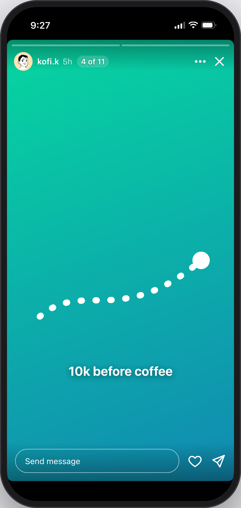

# CMPM 290A Project 2: Stories tray prototype

An interactive, front-end-only prototype of the **B** version for our Instagram Stories A/B
experiment, with the **A** (control) version a click away. All data is mock; every person and brand is
fictional.

| | A (control) | B (treatment) |
| --- | --- | --- |
| Stories viewer | Per-account segment bars only | Adds **tray progress**, e.g. "4 of 11", beside the username |
| Home tray, tray order, ads, gestures | Unchanged | Unchanged |

Progress label rules (from the experiment plan):
- The total is fixed when the viewer opens.
- Story ads aren't counted.
- Skipping an account still advances the count.
- It uses the same white as the segment bars.
- It's hidden when the viewer wasn't opened from the Home tray, or with fewer than 2 unseen accounts.



## Run it

Requires Node 22.12+ (Vite 8) and pnpm.

```sh
pnpm install
pnpm dev            # http://localhost:5190
```

URL options:

| Option | Effect |
| --- | --- |
| `?variant=A` or `?variant=B` | Pick the version (the console's switch does the same) |
| `?clean=1` | Hide the experiment console, for recordings |
| `?paused=1` | Turn off auto-advance, for stable screenshots |

Controls in the viewer:
- **Tap:** right side for the next story, left third for the previous one.
- **Hold:** pause.
- **Swipe left or right:** next or previous account.
- **Swipe down:** close.
- **Keys:** `←` `→` move between stories, `Shift+←` `Shift+→` between accounts, `Space` pauses, `Esc` closes.

## Tests

```sh
pnpm check   # svelte-check (types)
pnpm test    # unit: tray order, playlist, progress rules
pnpm e2e     # Playwright: A vs B, "N of 11" through skips and ads, exposure rules, auto-advance
```

## Deploy (optional)

Deployed on [Vercel](https://vercel.com). Import the repo in the Vercel dashboard; it detects Vite and pnpm automatically (build command `pnpm build`, output directory `dist`). Pushes to `main` deploy to production, and other branches get preview URLs.

## Credits

Avatars come from [DiceBear](https://www.dicebear.com/)'s "Lorelei" style, generated offline in the browser. The header uses a text wordmark in the Grand Hotel font; no Instagram brand assets are included.
