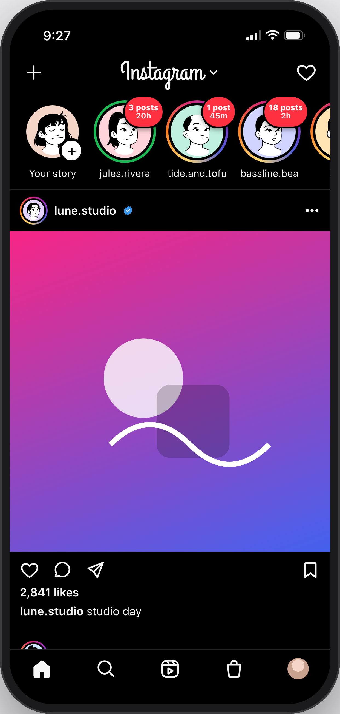

# CMPM 290A Project 2: Stories tray prototype

An interactive, front-end-only prototype of the **B** version for our Instagram Stories A/B
experiment, with the **A** (control) version a click away. All data is mock; every person and brand is
fictional.

| | A (control) | B (treatment) |
| --- | --- | --- |
| Story tray (Home) | Unchanged | Red badge on each circle with the account's **story count and age** (e.g. "3 posts / 20h") |
| Stories viewer | Per-account segment bars only | Adds **tray progress**, e.g. "4 of 11", beside the username |
| Tray order, ads, gestures | Unchanged | Unchanged |

Progress label rules (from the experiment plan):
- The total is fixed when the viewer opens.
- Story ads aren't counted.
- Skipping an account still advances the count.
- It uses the same white as the segment bars.
- It's hidden when the viewer wasn't opened from the Home tray, or with fewer than 2 unseen accounts.



## Run it

Requires Node 22.12+ (Vite 8) and pnpm.

```sh
pnpm install
pnpm dev            # http://localhost:5190
```

URL options:

| Option | Effect |
| --- | --- |
| `?variant=A` or `?variant=B` | Pick the version (the console's switch does the same) |
| `?clean=1` | Hide the experiment console, for recordings |
| `?paused=1` | Turn off auto-advance, for stable screenshots |

Controls in the viewer:
- **Tap:** right side for the next story, left third for the previous one.
- **Hold:** pause.
- **Swipe left or right:** next or previous account.
- **Swipe down:** close.
- **Keys:** `←` `→` move between stories, `Shift+←` `Shift+→` between accounts, `Space` pauses, `Esc` closes.

## Report deliverables

- **Hi-fi mocks of A and B:** run `pnpm mocks`. It writes `mocks/A-home.png`, `mocks/B-home.png`, `mocks/A-viewer.png`, `mocks/B-viewer.png` and `mocks/B-with-console.png`, at 3x iPhone resolution.
- **Screen recording:** open `/?variant=B&clean=1` and record the phone with any screen recorder, e.g. macOS Cmd+Shift+5, "Record Selected Portion". Suggested script:
  1. Show the tray badges, including "18 posts" on bassline.bea.
  2. Open **kofi.k**, which shows "4 of 11".
  3. Tap through, swipe to the next accounts, and pass the story ad: the count holds.
  4. Close.
  5. Switch to `?variant=A` to show the control.

**How the prototype maps to the report:**

| Report section | Where it shows |
| --- | --- |
| 2. Proposed change | The B variant |
| 3. Metric | Console, "Accounts viewed / tray session" (primary) and stories per session (guardrail) |
| 4. Randomization | The A/B switch stands in for user-level assignment: one variant per user, kept across sessions |
| 6. Triggering | Console event log. `story_progress_exposure {user_id, variant, session_id, unseen_accounts_at_open}` fires when the viewer opens from the tray, in both arms (a counterfactual log in A). It doesn't fire for viewers opened from a feed post's avatar, or with fewer than 2 unseen accounts. `story_badge_exposure` fires when the Home tray is shown. |

## Tests

```sh
pnpm check   # svelte-check (types)
pnpm test    # unit: badge text, tray order, playlist, progress rules
pnpm e2e     # Playwright: A vs B, "N of 11" through skips and ads, exposure rules, auto-advance
```

## Deploy (optional)

`.github/workflows/pages.yml` publishes to GitHub Pages on pushes to `main`. In the repo settings, set **Pages, Source** to **GitHub Actions**. The site is then at `https://audsostrom.github.io/cmpm290a-project2/`.

## Credits

Avatars come from [DiceBear](https://www.dicebear.com/)'s "Lorelei" style, generated offline in the browser. The header uses a text wordmark in the Grand Hotel font; no Instagram brand assets are included.
